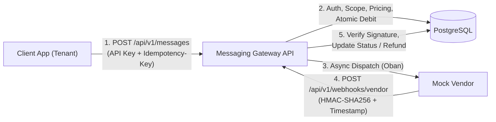

# Mini Multi-Tenant Messaging Gateway

Backend Elixir/Phoenix (API-only) untuk mengirim pesan SMS/WhatsApp berbayar dengan saldo *prepaid* per tenant, mengecek status pesan, dan menerima *Delivery Report* (DLR) vendor lewat webhook ber-HMAC.

Fokus implementasi: **security**, **integritas saldo di bawah concurrency**, dan **test yang membuktikan keduanya**.



| Endpoint | Auth | Scope |
|---|---|---|
| `POST /api/v1/messages` | `X-Client-Key` + `Authorization: Bearer <secret>` (+ `Idempotency-Key` opsional) | `messages:write` |
| `GET /api/v1/messages/:id` | `X-Client-Key` + `Authorization: Bearer <secret>` | `messages:read` |
| `POST /api/v1/webhooks/vendor` | `X-Webhook-Timestamp` + `X-Webhook-Signature: sha256=<hex>` | — |

**Stack:** Elixir `~> 1.16` (dikembangkan di 1.20 / OTP 29), Phoenix 1.8 + Bandit, Ecto + PostgreSQL 16, Oban, ExUnit. Dev/test: Credo, Sobelow, mix_audit.

---

## 1. Setup & menjalankan

Prasyarat: Elixir 1.16+ / OTP 26+, Docker (untuk Postgres), `bash`, `curl`, `openssl` (untuk contoh webhook).

```bash
docker compose up -d --wait     # Postgres 16 di localhost:55432 (override: DB_PORT=xxxx)
mix setup                       # deps.get + ecto.create + migrate + seeds
mix phx.server                  # http://localhost:4000
```

> Port host Postgres sengaja **55432**, bukan 5432, supaya tidak bentrok dengan Postgres lain di mesin reviewer. Ganti dengan env `DB_PORT` (dibaca oleh `docker-compose.yml` dan `config/dev.exs` / `config/test.exs`).

Seeds (`priv/repo/seeds.exs`) mencetak tabel credential **sekali** dan menulis `tmp/seed_credentials.env` (gitignored) berisi `export` variabel untuk curl. Secret di-generate acak tiap kali seed dijalankan; yang tersimpan di DB hanya hash-nya. Reset kapan saja dengan `mix ecto.reset`.

| Tenant | Saldo | Status | API keys (scope) | Channels | Templates |
|---|---|---|---|---|---|
| Acme Corp | 100.000 | active | `ACME` (write+read), `ACME_RO` (read) | `ACME_WA` whatsapp/utility, `ACME_SMS` sms/authentication, `ACME_WA_OLD` whatsapp/marketing **inactive** | `otp_login_v1` authentication approved `Kode OTP Anda adalah {{1}}`; `order_shipped_v1` utility approved `Halo {{1}}, pesanan {{2}} sedang dikirim.`; `promo_nov_v1` marketing **pending** |
| Globex Inc | 1.000 | active | `GLOBEX` (write+read), `GLOBEX_WO` (write) | `GLOBEX_WA` whatsapp/marketing | `otp_login_v1` authentication approved `Kode verifikasi Globex: {{1}}` |
| Initech | 50.000 | **suspended** | `INITECH` (write+read) | `INITECH_SMS` sms/utility | — |

Production: semua secret dari env (`DATABASE_URL`, `SECRET_KEY_BASE`, `WEBHOOK_SECRET`, `API_KEY_PEPPER`; lihat `.env.example`). `config/runtime.exs` menolak boot kalau `WEBHOOK_SECRET` / `API_KEY_PEPPER` kosong atau < 32 byte.

## 2. Test & lint

```bash
mix test        # 120 test; suite concurrency memakai koneksi Postgres sungguhan
mix lint        # format --check-formatted + credo --strict + sobelow
mix deps.audit && mix hex.audit
```

`mix test` butuh Postgres dari `docker compose` yang sedang jalan. Tidak ada test yang meng-assert jumlah baris global, jadi aman diulang (`mix test --repeat-until-failure 3` di Elixir 1.17+).

## 3. Mencoba dengan curl

```bash
source tmp/seed_credentials.env
```

**Kirim pesan** (template `authentication` → cost 300). Kirim dua kali dengan `Idempotency-Key` yang sama: response kedua punya `id` yang sama, header `idempotent-replayed: true`, dan saldo tidak dipotong lagi.

```bash
curl -sS -i -X POST "$BASE_URL/api/v1/messages" \
  -H "X-Client-Key: $ACME_CLIENT_KEY" -H "Authorization: Bearer $ACME_SECRET" \
  -H "Idempotency-Key: order-123" -H 'Content-Type: application/json' \
  -d "{\"channel_id\":\"$ACME_WA_ID\",\"recipient\":\"+6281234567890\",\"text\":\"Kode OTP Anda adalah 849201\",\"template_code\":\"otp_login_v1\",\"metadata\":{\"reference_id\":\"order-123\",\"campaign\":\"checkout\"}}"
```

```json
{"data":{"id":"…","channel_id":"…","recipient":"+6281234567890","template_code":"otp_login_v1","category":"authentication","cost":300,"status":"queued","failure_reason":null,"metadata":{"reference_id":"order-123","campaign":"checkout"},"inserted_at":"2026-11-23T07:00:00.123456Z","updated_at":"…"}}
```

```bash
export MSG_ID=<id dari response di atas>
```

**Cek status** (beberapa ratus ms kemudian Oban sudah mendispatch ke mock vendor → `sent`):

```bash
curl -sS "$BASE_URL/api/v1/messages/$MSG_ID" \
  -H "X-Client-Key: $ACME_CLIENT_KEY" -H "Authorization: Bearer $ACME_SECRET"
```

**Webhook DLR** (signature dihitung atas raw body persis yang dikirim):

```bash
TS=$(date +%s); BODY="{\"message_id\":\"$MSG_ID\",\"status\":\"failed\",\"reason\":\"recipient_unreachable\"}"
SIG=$(printf '%s.%s' "$TS" "$BODY" | openssl dgst -sha256 -hmac "$WEBHOOK_SECRET" | sed 's/^.* //')
curl -sS -X POST "$BASE_URL/api/v1/webhooks/vendor" -H 'Content-Type: application/json' \
  -H "X-Webhook-Timestamp: $TS" -H "X-Webhook-Signature: sha256=$SIG" --data-raw "$BODY"
# {"data":{"message_id":"…","status":"failed","result":"updated"}}   -> saldo Acme kembali 100.000
# ulangi perintah curl yang sama -> "result":"unchanged", tidak ada refund kedua
```

**Contoh negatif:**

| Skenario | Hasil |
|---|---|
| `ACME_RO` (read-only) `POST /messages` | `403 insufficient_scope` |
| `GLOBEX` `GET` pesan milik Acme, id acak, atau `not-a-uuid` | `404 not_found` (body identik) |
| Key `INITECH` (tenant suspended) | `403 tenant_suspended` |
| Secret salah / header hilang / `Basic` scheme | `401 unauthorized` (body identik) |
| `GLOBEX` kirim teks biasa ke `GLOBEX_WA` (marketing 1000) dua kali | `201`, lalu `402 insufficient_balance` |
| `ACME` pakai template `promo_nov_v1` (pending) | `422 template_not_approved` |
| `ACME` pakai `otp_login_v1` dengan teks `"DISKON 90%!"` | `422 template_mismatch` |
| `ACME` pakai `channel_id` milik Globex | `422 channel_not_found` |
| Webhook dengan signature salah atau timestamp > 5 menit | `401 invalid_signature` |

Contoh template mismatch:

```bash
curl -sS -X POST "$BASE_URL/api/v1/messages" \
  -H "X-Client-Key: $ACME_CLIENT_KEY" -H "Authorization: Bearer $ACME_SECRET" -H 'Content-Type: application/json' \
  -d "{\"channel_id\":\"$ACME_WA_ID\",\"recipient\":\"+6281234567890\",\"text\":\"DISKON 90%!\",\"template_code\":\"otp_login_v1\"}"
# {"error":{"code":"template_mismatch","message":"Text does not match the template body"}}
```

Format error selalu `{"error": {"code": "<snake_case>", "message": "…", "details": {…}}}` (`details` hanya untuk `validation_failed`).

## 4. Arsitektur

Tiga context:

- **`Accounts`**: tenant, API key, autentikasi (`lib/messaging_gateway/accounts.ex`).
- **`Messaging`**: channel, template, message, `SendRequest` (batas input), `TemplateMatcher`, `StatusMachine` (`lib/messaging_gateway/messaging.ex`).
- **`Billing`**: tabel harga server-side dan ledger `balance_transactions` (`lib/messaging_gateway/billing.ex`).

**Alur `POST /messages`** (satu transaksi Postgres):

1. Plug: auth API key → rate limit per key → cek scope.
2. `SendRequest.validate/1`: whitelist field, normalisasi metadata, fingerprint request.
3. Kalau ada `Idempotency-Key` dan sudah pernah dipakai tenant ini: fingerprint sama → replay, beda → `422 idempotency_key_reused`.
4. Resolusi channel & template **hanya milik tenant ini** → kategori → harga dari `Pricing`.
5. `Ecto.Multi`: insert message (`queued`) → `UPDATE tenants SET balance = balance - cost WHERE id = ? AND status = 'active' AND balance >= cost RETURNING balance` → insert ledger `debit` → insert job Oban. Semua commit bersama atau rollback bersama (*transactional outbox*: tidak ada pesan terbayar yang tidak ter-dispatch, dan sebaliknya).

**Webhook / perubahan status:** `SELECT … FOR UPDATE` pada message → `StatusMachine.check/2` (`queued→sent|failed`, `sent→delivered|failed`; status sama = no-op; selain itu `409`) → update status → kalau `failed`, refund `cost` + ledger `refund`.

**Urutan lock (anti-deadlock):** create = insert message → lock tenant; refund = lock message → lock tenant; dispatch worker = lock message saja. Tidak ada siklus. Diuji dengan race campuran send + refund di satu tenant.

**Dispatch:** `Dispatch.Worker` (Oban, `max_attempts: 3`) memanggil `Vendor.Mock` (recipient `+999…` disimulasikan gagal). Gagal sampai attempt terakhir → message `failed` + refund otomatis. Args job hanya `message_id`, jadi isi pesan tidak tersimpan di `oban_jobs`.

## 5. Security notes / threat model

| Ancaman | Mitigasi | Test |
|---|---|---|
| Kebocoran DB membuka API secret | Secret = 32 byte CSPRNG (`sk_…`). Yang disimpan hanya `HMAC-SHA256(API_KEY_PEPPER, secret)`; pepper ada di env, bukan DB. Plaintext dikembalikan sekali saat dibuat. | `accounts_test.exs` |
| Timing attack pada secret / signature | `Plug.Crypto.secure_compare/2`. `client_key` tak dikenal tetap menjalankan hash + compare dummy (anti enumerasi). | `accounts_test.exs`, `signature_test.exs` |
| Oracle kredensial | Semua kegagalan → `401` dengan body identik + `www-authenticate: Bearer`. Header ganda, `Basic`, secret 10 KB ditolak tanpa crash. Status `suspended` hanya diungkap ke pemegang secret yang benar. | `authenticate_api_key_test.exs` |
| Scope bypass | `RequireScope` per action: `403 insufficient_scope`. | `require_scope_test.exs`, `message_controller_test.exs` |
| IDOR lintas tenant | Semua query di-scope `tenant_id`. Channel/template milik tenant lain = "not found". `GET` id asing, acak, atau bukan UUID → `404` identik. **Composite FK** `messages(channel_id, tenant_id) → channels(id, tenant_id)` dan `balance_transactions(message_id, tenant_id) → messages(id, tenant_id)` membuat IDOR mustahil di level DB. | `send_message_test.exs`, `message_controller_test.exs`, `schema_constraints_test.exs` |
| Manipulasi harga/kategori/status/tenant | Hanya `channel_id, recipient, text, template_code, metadata` yang dibaca, dan hanya dari JSON body (query string diabaikan). Key cadangan (`tenant_id cost price category status channel_id id`, case-insensitive) dibuang dari metadata. Metadata tidak pernah dibaca oleh pricing. | `send_request_test.exs`, `send_message_test.exs`, `message_controller_test.exs` |
| Arbitrase kategori (kirim promo lewat template OTP yang murah) | Teks wajib cocok dengan `body_pattern` template (`{{n}}` = wildcard ≥ 1 byte): teks tetap template harus ada utuh di posisinya, jadi teks bebas tanpa template, atau promo yang ditaruh sebelum/di sela teks tetap, ditolak. Matcher linear berbasis `:binary.match`, tanpa regex dari data tenant (bebas ReDoS). **Sisa risiko:** isi parameter tidak dibatasi (selain batas 4096 karakter), jadi `Kode OTP Anda adalah 1 PROMO…` masih lolos. Lihat trade-off. | `template_matcher_test.exs`, `send_message_test.exs` |
| Double-spend / saldo negatif | Debit = satu `UPDATE … WHERE balance >= cost` yang atomik; CHECK `balance >= 0` sebagai backstop. Terbukti: 20 request paralel dengan saldo untuk 3 → tepat 3 sukses, saldo 0. Test ini **gagal** kalau debit diganti read-then-write (sudah dicoba). | `concurrency_test.exs`, `billing_test.exs` |
| Double charge saat retry client | Unique partial index `(tenant_id, idempotency_key)`. Request paralel dengan key sama menunggu di index lalu di-replay: 10 paralel → 1 created, 9 replayed, 1 debit. | `concurrency_test.exs`, `send_message_test.exs` |
| Double refund (webhook retry/paralel) | Row lock `FOR UPDATE` + state machine (status sama = no-op) + `UNIQUE (message_id, type)` di ledger. 10 webhook paralel lewat HTTP → 1 refund. | `concurrency_test.exs`, `webhook_controller_test.exs`, `status_update_test.exs` |
| Webhook palsu / dimodifikasi | HMAC-SHA256 atas **raw body** (di-cache oleh custom `body_reader`, hanya untuk path webhook), format header ketat (`sha256=` + 64 hex lowercase), compare constant-time. Semua kegagalan → `401` seragam; alasan spesifik hanya di log. | `signature_test.exs`, `webhook_controller_test.exs` |
| Replay webhook | Timestamp wajib digit, toleransi ±300 detik. Replay *di dalam* window tetap aman karena update status idempotent (tidak ada efek ganda). | `signature_test.exs`, `webhook_controller_test.exs` |
| Atom exhaustion | Enum selalu string, tidak ada `String.to_atom` / `keys: :atoms` di `lib/` (di-grep oleh test). Test mengirim ratusan key acak dan memastikan atom count tidak naik. | `atom_safety_test.exs` |
| Secret / OTP / PII di log | `filter_parameters` (secret, token, authorization, text, content, recipient, metadata), query log Ecto **mati di semua env**, field `redact: true` (secret_hash, content, recipient) sehingga `inspect/1` di crash report aman. `GET` tidak mengembalikan `content`. | `log_hygiene_test.exs`, `schema_constraints_test.exs` |
| Body berbahaya | Hanya JSON, max 64 KB (`413`), content-type lain `415`, JSON rusak `400`, root non-object / tipe salah → `422`. Tidak pernah `500`. | `endpoint_test.exs`, `message_controller_test.exs` |
| Abuse / kuota habis | Rate limit per API key (ETS fixed window, `:ets.update_counter` atomik), dijalankan **setelah** auth supaya `client_key` publik tidak bisa menghabiskan kuota tenant. `429` + `retry-after`. | `rate_limiter_test.exs`, `rate_limit_test.exs` |
| Permukaan serangan HTTP | Endpoint tanpa session/static/method-override; `cache-control: no-store`, `x-content-type-options: nosniff`; `force_ssl` + HSTS di prod. | `message_controller_test.exs` |

## 6. Keputusan & trade-off

- **Tanpa Ash.** Untuk 3 endpoint, Ecto eksplisit membuat jaminan transaksi finansial (urutan lock, conditional update, ledger) lebih mudah dibaca dan dibuktikan. Ash menambah kurva belajar tanpa menambah jaminan di sini.
- **HMAC + pepper, bukan bcrypt/Argon2.** Secret 256-bit acak tidak bisa di-brute-force, jadi slow hash tidak menambah keamanan; bcrypt per request justru membuka DoS CPU. Pepper di env berarti dump DB saja tidak cukup untuk memverifikasi tebakan.
- **Template body matching lebih ketat dari spec.** Spec hanya minta template milik tenant + `approved`. Kami juga mewajibkan teks cocok dengan template, karena tanpa itu tenant bisa membayar tarif `authentication` (300) untuk konten `marketing` (1000). Ini juga perilaku WhatsApp Business: template message harus sesuai template yang di-approve. Batasannya: ini mempersempit arbitrase, tidak menutupnya. Konten masih bisa diselipkan *di dalam* nilai parameter, terutama parameter terakhir. Batas panjang per parameter tidak benar-benar menolong (promo pendek tetap muat). Langkah berikutnya: aturan per parameter (mis. parameter template `authentication` hanya boleh `\A[0-9A-Za-z-]{4,15}\z`, seperti template OTP Meta) yang disimpan bersama template.
- **`Idempotency-Key` dipakai ulang dengan body berbeda → `422`.** Spec tidak membahasnya. Mengembalikan pesan lama diam-diam akan membuat client mengira pesan barunya terkirim. Pola ini mengikuti Stripe / draft IETF Idempotency-Key.
- **Replay idempotency mengembalikan state pesan saat ini** (mis. sudah `sent`), bukan snapshot response pertama.
- **`queued → delivered` ditolak (`409`)**, sesuai daftar transisi di spec. Bisa dilonggarkan kalau vendor riil mengirim DLR out-of-order.
- **`GET` tidak mengembalikan `content`** (minimisasi data: isi OTP tidak bisa dibaca ulang lewat API, termasuk oleh key read-only).
- **Key metadata cadangan dibuang diam-diam**, bukan ditolak, supaya client legacy tidak rusak.
- **Validasi input ketat:** recipient wajib E.164 (`+62…`), metadata flat (≤ 20 key, value skalar ≤ 500 karakter), `text` ≤ 4096 karakter.
- **Rate limit per node** (ETS). Multi-node butuh store bersama (Redis / Hammer backend terdistribusi).
- **Body di-parse sebelum auth / sebelum verifikasi signature.** Dibatasi 64 KB dan tidak ada state yang berubah sebelum verifikasi; verifikasi tetap dilakukan atas raw bytes.
- **`debug_errors` dimatikan di dev**, jadi error tetap memakai envelope JSON. Halaman debug HTML Phoenix akan menampilkan ulang header request (termasuk `Authorization`) di response.
- **Query log Ecto dimatikan juga di dev**, karena parameter query memuat isi pesan dan recipient. Nyalakan sementara (`log: :debug` di `config/dev.exs`) hanya untuk debugging lokal.
- **Belum dikerjakan:** kedaluwarsa idempotency key; ledger append-only baru dijaga konvensi (berikutnya: `REVOKE UPDATE, DELETE` untuk role aplikasi); enkripsi isi pesan at-rest; rotasi webhook secret (multi-secret verify); mock vendor tidak memanggil webhook sendiri (DLR disimulasikan lewat curl).
